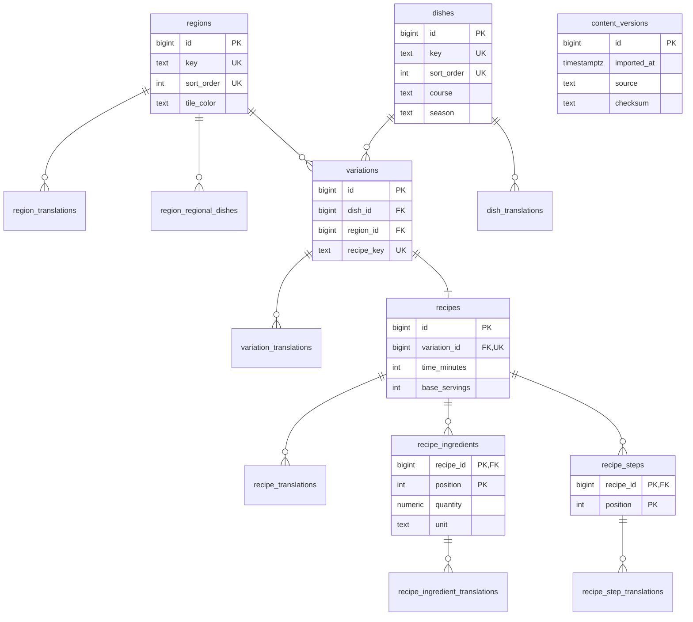

# Database schema

Written by hand from `db/migrations/` (00002–00008); the migrations are the source of truth.

## Conventions

Every human-readable field lives in a `*_translations` table keyed by its parent plus `locale`, which references the `locales` table (`en`, `es`, `ru`). Imports must supply all three locales (D-BE3-3). Regional dish names (`region_regional_dishes.name`) are Spanish proper names, so they're stored once and not translated. Keys (`regions.key`, `dishes.key`, `variations.recipe_key`) are ASCII slugs matching `^[a-z0-9]+(-[a-z0-9]+)*$`, enforced by check constraints. Editorial order is `regions.sort_order` and `dishes.sort_order`, both unique. Variations have no rank, `is_primary` or sort column: a dish's variations are all equal and are listed in region order. Every foreign key from a child to its parent is `ON DELETE CASCADE` and is backed by an index; foreign keys to `locales` are `RESTRICT`. Tables with `updated_at` keep it current with the `set_updated_at()` trigger. A recipe's time is stored as `time_minutes`, an integer the frontend formats (D-BE3-1); the optional `recipe_translations.time_note` adds text such as "+ soaking", and a recipe without a note has no rows there.

## Tables

| Table | Key | Columns and constraints |
|-------|-----|-------------------------|
| `locales` | `code` | Seeded with `en`, `es`, `ru` |
| `regions` | `id` | `key` unique slug, `sort_order` unique, `tile_color` `#RRGGBB`, timestamps |
| `region_translations` | `(region_id, locale)` | `name`, `map_label`, `description` |
| `region_regional_dishes` | `(region_id, position)` | `name` (untranslated) |
| `dishes` | `id` | `key` unique slug, `sort_order` unique, `course` (`tapas\|mains\|desserts`), `season` (`summer\|winter\|easter\|all`), flags `is_vegetarian`, `is_seafood`, `has_pork`, `is_quick`, `is_slow_cooked` (default false), nullable `photo_thumb`/`photo_card`/`photo_hero`, timestamps |
| `dish_translations` | `(dish_id, locale)` | `name`, `description` |
| `variations` | `id` | `dish_id`, `region_id`, unique `(dish_id, region_id)`, `recipe_key` unique slug, nullable photo keys |
| `variation_translations` | `(variation_id, locale)` | `name`, `description` |
| `recipes` | `id` | `variation_id` unique (1:1), `time_minutes > 0`, `base_servings` 1–20 |
| `recipe_translations` | `(recipe_id, locale)` | `time_note` (optional per recipe) |
| `recipe_ingredients` | `(recipe_id, position)` | `quantity numeric(10,3) > 0`, `unit` NULL (counted) or `g\|ml\|tsp` |
| `recipe_ingredient_translations` | `(recipe_id, position, locale)` | `name` |
| `recipe_steps` | `(recipe_id, position)` | none beyond the key |
| `recipe_step_translations` | `(recipe_id, position, locale)` | `text` |
| `content_versions` | `id` | `imported_at`, `source`, `checksum`; the latest row feeds the API ETag |

Positions are 1-based.

## ERD

Translation tables also reference `locales`; those edges are left out for readability.

